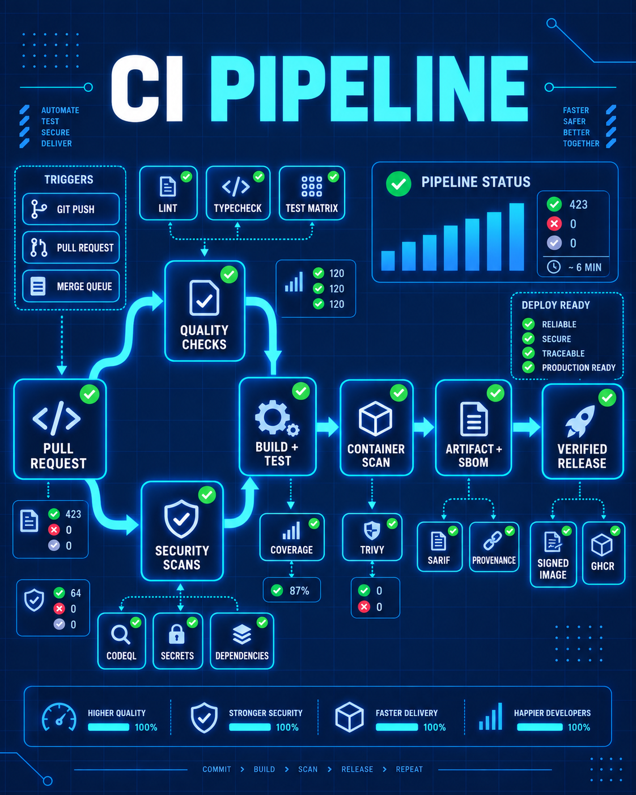
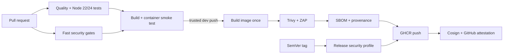

# CI with GitHub Actions

[](https://github.com/awaismansha-00/ci-with-github-actions/actions/workflows/ci.yml)
[](https://github.com/awaismansha-00/ci-with-github-actions/actions/workflows/security-audit.yml)
[](LICENSE)

<p align="center">
  
</p>

A hands-on path from a first GitHub Actions workflow to a hardened CI and
software-supply-chain pipeline. The repository combines short concept guides,
manual labs, a real TypeScript service, production CI, and isolated security
fixtures.

> This repository intentionally stops at CI. It publishes artifacts, signed
> container images, SBOMs, attestations, and releases, but it does not deploy to
> AWS, Kubernetes, Argo CD, or another runtime environment.

## What you will learn

- Workflow syntax, events, jobs, matrices, caching, artifacts, reuse, and releases.
- TypeScript quality gates across supported Node 22 and Node 24 LTS lines.
- Secret, workflow, source, dependency, IaC, Dockerfile, image, and DAST scanning.
- Least-privilege tokens, immutable action references, fork safety, and OIDC.
- Risk-based gates, durable reports, expiring exceptions, SBOMs, provenance, and signing.

## Pipeline architecture



The default permission is `contents: read`. Package, attestation, identity-token,
and release permissions exist only on trusted publishing jobs.

## Quick start

Requirements: Git, Node 24, npm, and optionally Docker.

```bash
cd demo-app
npm ci
npm run check
npm run dev
```

Then open `http://127.0.0.1:3000/health` and
`http://127.0.0.1:3000/api/message`.

Run repository policy validation from the root:

```bash
npm ci
npm run validate
```

## Learning roadmap

1. Work through [`docs/01`–`docs/17`](docs/01-ci-cd-and-github-actions.md) for CI fundamentals.
2. Run manual labs 01–10 from the Actions tab.
3. Continue with [`docs/18`–`docs/32`](docs/18-devsecops-threat-model.md) for the security track.
4. Run security labs 11–20 against the isolated fixtures.
5. Read [`security/risk-policy.md`](security/risk-policy.md) before changing a gate.

Every lab is manual-only. The automatic workflows never scan or package the
intentionally insecure fixtures.

## Automatic workflows

| Workflow | Trigger | Purpose |
| --- | --- | --- |
| `ci.yml` | PR to dev, dev push, dev merge queue, manual on dev | Quality, tests, build, fast security, container smoke test |
| `codeql.yml` | PR to dev, dev push, weekly on dev | GitHub-native TypeScript SAST and SARIF upload |
| `security-audit.yml` | Weekly on dev, manual on dev | Full-history and deeper report-oriented audit |
| `release.yml` | `v*.*.*` tags | Gated GHCR image, SBOM, attestation, signature, GitHub Release |
| `sonar.yml` | Manual on dev | Optional SonarQube/SonarCloud integration |

The production workflows use immutable action SHAs with version comments.
Dependabot proposes updates for both npm packages and GitHub Actions.

## Security layers

| Layer | Tools and controls |
| --- | --- |
| Secrets | Gitleaks; documented GitHub secret scanning and push protection |
| Workflow | Actionlint, Zizmor, immutable-pin validator, least privilege |
| SAST | CodeQL and ESLint security rules; optional Sonar |
| Dependencies | Dependency Review, npm audit, Trivy, Dependabot |
| Configuration | Checkov and Hadolint |
| Container | Trivy image scan, non-root runtime, one-build digest discipline |
| Supply chain | SPDX SBOMs, GitHub attestations, keyless Cosign signatures |
| Runtime surface | OWASP ZAP against a workflow-owned local target only |

Security commands produce machine-readable evidence and human summaries.
Blocking severity is defined in the [risk policy](security/risk-policy.md), not
hidden inside ad hoc `continue-on-error` statements.

## Repository structure

```text
.
├── .github/
│   ├── actions/setup-node-project/  # local composite action
│   ├── workflows/                   # automatic, reusable, and manual labs
│   └── dependabot.yml
├── assets/                          # Mermaid diagram sources
├── demo-app/                        # TypeScript Express API and Dockerfile
├── docs/                            # numbered learning path (01–32)
├── labs/                            # instructions for manual workflows
├── notes/                           # commands and cheat sheets
├── scripts/                         # pin, boundary, and exception validators
└── security/                        # policy, configs, and isolated fixtures
```

## Repository settings checklist

- Enable Actions and set default `GITHUB_TOKEN` permissions to read-only.
- Enable dependency graph, Dependabot alerts, secret scanning, and push protection.
- Make `quality`, both matrix tests, build, smoke test, and security checks required.
- Enable CodeQL code-scanning merge protection for high and critical findings.
- Protect `dev`; require pull requests and dismiss stale approvals.
- After the first image publication, link the GHCR package to this repository and make it public.
- Configure `SONAR_TOKEN` and `SONAR_HOST_URL` only if using the optional Sonar workflow.

## Status

- [x] Runnable TypeScript demo app
- [x] CI fundamentals and manual labs
- [x] Pull-request security profile
- [x] Secure container and release workflows
- [x] Scheduled audit and optional Sonar integration
- [x] Secure/insecure fixtures and exception lifecycle
- [x] Documentation, diagrams, and operational notes

See [CONTRIBUTING.md](CONTRIBUTING.md) for changes and [SECURITY.md](SECURITY.md)
for responsible vulnerability reporting.
